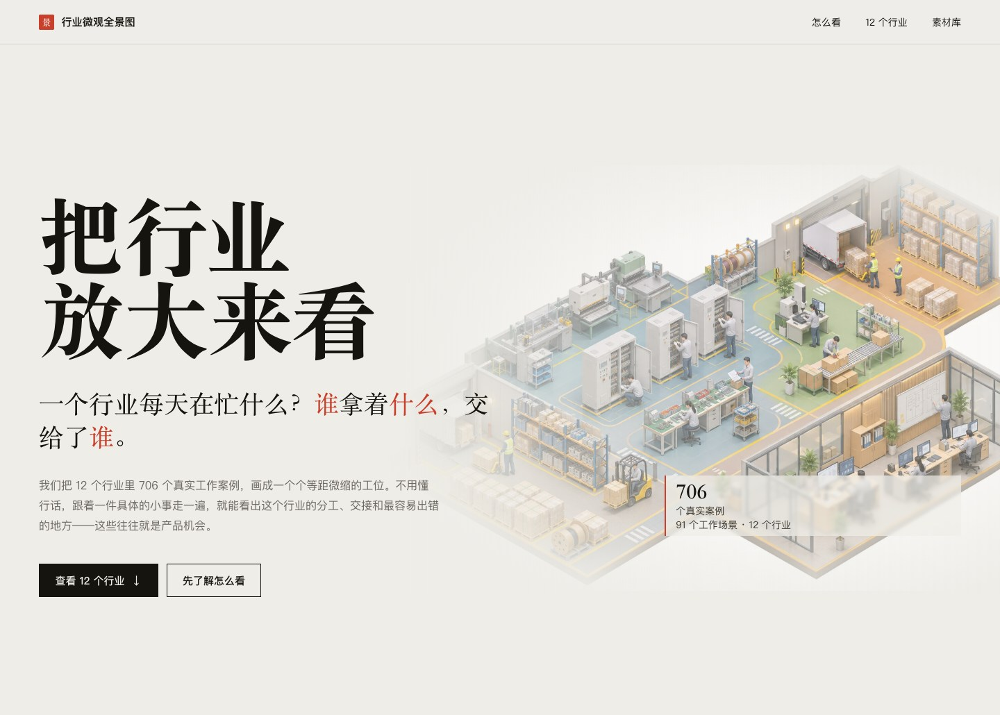
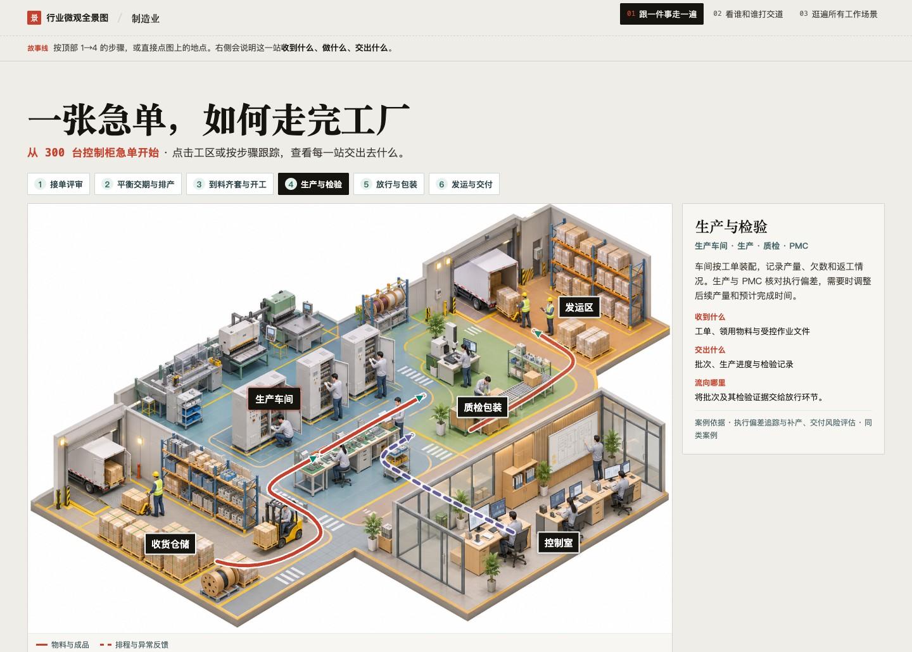

# 行业微观全景图 · Industry Panorama

**用可点击的等距场景图，看懂一个行业怎样运转。** 从上下游交接或一条业务主线入手，点进工作区，再下钻到岗位、业务对象和原始案例。适合行业研究、产品调研和新人培训。

**12 个行业分类 · 706 个业务案例 · 57 件可复用等距素材**

[浏览全行业交互首页](https://kz-aven.github.io/industry-panorama/outputs/case-library/index.html) · [体验制造业急单案例](https://kz-aven.github.io/industry-panorama/outputs/manufacturing-floor-map.html) · [查看 Codex 技能](SKILL.md)

## 行业全景交互首页

[](https://kz-aven.github.io/industry-panorama/outputs/case-library/index.html)

打开首页后，选一个行业进入「业务全景」。沿着**上下游旅程图**看供应商、服务方和客户之间交付什么。进入**连续工作区**，看相邻岗位在哪里协同。也可切换**部门泳道**或**对象追踪**，了解谁接手一条流程，或者拿着订单号、工单号、批号怎样回查。

如果已经有具体问题，可以直接搜索案例。案例详情保留岗位、场景痛点和原文定位，正文有独立工作步骤时可展开查看。

## 制造业案例 · 一张急单，如何走完工厂

[](https://kz-aven.github.io/industry-panorama/outputs/manufacturing-floor-map.html)

从一张 **300 台控制柜急单** 出发，沿接单评审、排产、齐套开工、生产检验、放行包装和发运六步走一遍。点击工区即可查看「收到什么」「交出什么」「流向哪里」，也能切换到缺料、产能冲突或客诉追溯分支。接单评审、交期平衡和排产调整沿用同一急单情境，后续工作区与环节按相关案例归纳。

[打开急单交互图](https://kz-aven.github.io/industry-panorama/outputs/manufacturing-floor-map.html) · [查看制造业业务全景与 66 个案例](https://kz-aven.github.io/industry-panorama/outputs/manufacturing-business-journey.html)

## 浏览行业

| 业务领域 | 交互全景 |
| --- | --- |
| 制造与履约 | [制造业](https://kz-aven.github.io/industry-panorama/outputs/manufacturing-business-journey.html) · [交通物流](https://kz-aven.github.io/industry-panorama/outputs/case-library/logistics-business-journey.html) · [消费零售](https://kz-aven.github.io/industry-panorama/outputs/case-library/consumer-retail-business-journey.html) |
| 技术与内容 | [信息技术](https://kz-aven.github.io/industry-panorama/outputs/case-library/information-technology-business-journey.html) · [数字创意](https://kz-aven.github.io/industry-panorama/outputs/case-library/digital-creative-business-journey.html) · [教育科研](https://kz-aven.github.io/industry-panorama/outputs/case-library/education-research-business-journey.html) |
| 公用与建设 | [政务公共](https://kz-aven.github.io/industry-panorama/outputs/case-library/public-services-business-journey.html) · [能源公用](https://kz-aven.github.io/industry-panorama/outputs/case-library/energy-utilities-business-journey.html) · [建筑文旅](https://kz-aven.github.io/industry-panorama/outputs/case-library/construction-tourism-business-journey.html) |
| 专业与通用 | [医疗健康](https://kz-aven.github.io/industry-panorama/outputs/case-library/medical-health-business-journey.html) · [金融](https://kz-aven.github.io/industry-panorama/outputs/case-library/finance-business-journey.html) · [跨行业通用场景](https://kz-aven.github.io/industry-panorama/outputs/case-library/universal-business-journey.html) |

**离线查看。** 克隆或下载仓库，用浏览器打开 [全行业首页 HTML](outputs/case-library/index.html) 或 [制造业急单 HTML](outputs/manufacturing-floor-map.html)。单张业务全景与急单交互图可以单独打开。全行业首页的链接使用相对路径，离线浏览时保留整个 `outputs/` 目录。

## 用 Codex 生成自己的等距业务图

项目内的 [Isometric Scene Composer](SKILL.md) 可以把行业研究笔记、访谈、流程说明和案例整理为等距场景、业务流程图和交互式行业全景。场景由人物、设备、工具等独立素材组装。同址工作区可以拼在一块底板上，跨地点交接用旅程路线连接。

1. 在 Codex 中打开本仓库，指定使用 [SKILL.md](SKILL.md)。
2. 提供案例目录、目标读者和希望讲清楚的主线。
3. 指定交付格式。离线单文件 HTML 适合交互浏览，SVG 和透明 PNG 适合文档或演示，Atlas JSON 适合继续维护，也可导出 FossFLOW 兼容文件。

> 用 Isometric Scene Composer 为第一次接触制造业的人制作一份离线 HTML。以客户订单为主线，展示供应商、工厂、仓配和客户之间的交接。点击工区可查看工作动作、交接物和相关案例来源。

### 命令行快速开始

需要 Node.js 20 或以上版本。导出 PNG 和 FossFLOW 需要 `rsvg-convert`。

```bash
git clone https://github.com/Kz-Aven/industry-panorama.git
cd industry-panorama
npm ci

npm run scene -- atlas examples/manufacturing-atlas/atlas.json \
  --format html -o outputs/my-manufacturing-atlas.html
```

[浏览素材库](https://kz-aven.github.io/industry-panorama/outputs/asset-library.html) · [素材制作与扩展](references/assets.md) · [布局与业务语义](references/scene-planning.md) · [技术架构](docs/architecture.md) · [验收与复验](evals/report.md)

## About

Industry Panorama is a Chinese-language **interactive industry atlas** and **isometric business process visualization** toolkit. It combines supply-chain journey maps, workplace dioramas, swimlanes, and a searchable case library. The Isometric Scene Composer Codex skill and Node.js CLI export offline HTML, SVG, PNG, and FossFLOW-compatible diagrams.

[MIT License](LICENSE)
