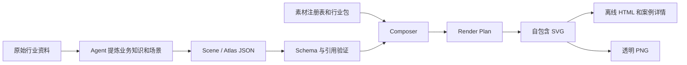

# 技术架构

- **输入**。Agent 从文档、HTML、JSON 或描述提取语义，记录可重定位的来源。CLI 用 Ajv 校验 Draft-07 Schema，随后检查跨记录 ID 和业务引用。CLI 不调用 LLM。
- **素材与模板**。内置素材 ID 指向可缓存的方向 PNG 或 SVG 文件及 SHA-256，使用场景统一标尺和地面锚点。底板变体提供材质面色。模板提供槽位和参考尺寸。行业包从 `industry-packs/<id>/manifest.yaml` 扫描读取。新增行业只需提供资料、行业包、所需素材和场景数据。
- **布局**。Composer 解析槽位和显式坐标，以承托表面的高度确定置于桌面的物件 z。检查旋转后的占地、高度、支撑范围与底板边界。投影为 `(x-y)cos30°` 与 `(x+y)sin30°-z`。用地面分隔、高度和支撑关系确定绘制依赖，对剩余同层物体按地面深度排序。视窗包含底板、阴影和物体边界。
- **输出**。SVG 内嵌素材。HTML 将图形、语义数据和界面代码写入单文件，以标签、场景及案例 ID 绑定。PNG 由 `rsvg-convert` 稳定栅格化。Chrome 仅用于可选浏览器验收。离线运行无需外部 API。
- **素材提供方式**。本地 Provider 读取已登记文件。程序化 Provider 由 `assets:build` 生成 SVG 和注册表。外部 Provider 将经过归一的本地 SVG 注册成独立 draft，核准后与本地素材使用同一读取契约。后续 Provider 只需产出相同注册元数据和媒体文件。写实素材由内置 ImageGen 生产，经过四向拆分和审核后登记。浏览、验证和渲染均读取已保存的本地文件。
- **适配边界**。渲染器消费 Render Plan 与业务 JSON。FossFLOW 适配器独立输出 v1.0.6 原生绘图 JSON。单个场景合成透明 PNG，以投影后的底板中心对齐节点。区域、连线与文字为原生绘图元素。独立映射文件用稳定 ID 关联合成图、案例、素材和来源。

## 实施与验收记录

1. 先查看本地文件和参考图，按可访问上游资料及既有本地导出核对生态。选择 Node.js ESM 与原生 SVG，以便复用现有运行时并保持离线。
2. 定义 Schema、素材注册、行业包与四模板，实现 Composer、SVG、HTML、PNG 和 CLI。验收碰撞、来源、固定输出和缺失报告。
3. 从原始导出解析制造业分类、案例及三种知识视图，先生成生产与质检，再生成全景、PMC 和财务例子。用离线浏览器和截图验收交互及双端布局。
